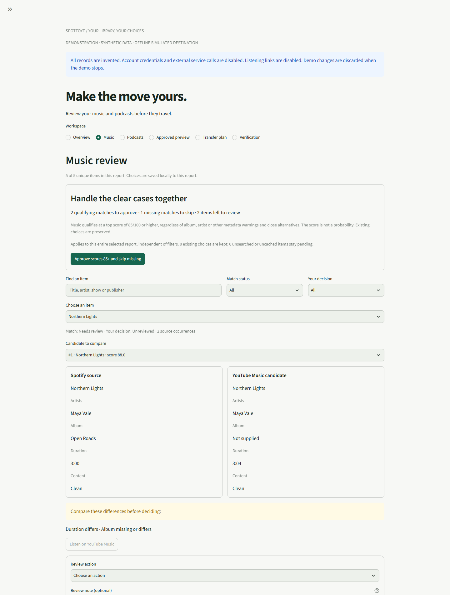
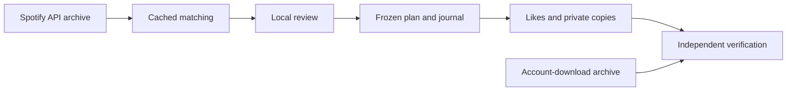

# Spottoyt

Archive Spotify data, review YouTube Music matches, and transfer supported likes
and private playlists with resumable checkpoints and independent verification.



## Setup

Windows PowerShell, Python 3.12, from the repository directory:

```powershell
py -3.12 -m venv .venv
.\.venv\Scripts\python.exe -m pip install -r requirements.lock
.\.venv\Scripts\python.exe -m pip install --no-build-isolation --no-deps -e .
.\.venv\Scripts\spottoyt.exe doctor
```

Activation and PowerShell execution-policy changes are unnecessary. The lockfile
records the tested Windows/Python environment, not a cross-platform lock.

## Try without accounts

```powershell
.\.venv\Scripts\spottoyt.exe demo
```

Open **http://127.0.0.1:8502**. Every record is invented and the destination is a
temporary local simulation. Credentials and external service calls are disabled.
Ctrl+C stops the server and discards demo changes. `demo --walkthrough` runs the
same pipeline without a browser. See the [demo guide](docs/demo.md).

## Real-account workflow

Follow [account setup](docs/authentication.md), then:

```powershell
.\.venv\Scripts\spottoyt.exe export-spotify
.\.venv\Scripts\spottoyt.exe match-music --limit 20 --request-budget 20
.\.venv\Scripts\spottoyt.exe review
```

The review UI opens at **http://127.0.0.1:8501**. Review candidates, prepare a
plan, check the connected destination, and explicitly authorize execution.
The matching example searches a bounded sample; viewing reports makes no account
changes. Music bulk approval accepts the top available score at 85/100 or higher,
preserving existing manual choices. Scores are heuristics, not probabilities.

Partial copies retain source-position checkpoints and intentional duplicates.
Later approvals fill the same playlist copies in source order. Resume the same
plan after interruption; prepare a new plan after changing review choices.
Changed source order or external playlist edits stop automatic completion.

Guides: [archives](docs/archives.md), [music matching](docs/music-matching.md),
[podcasts](docs/podcast-matching.md), [review](docs/review-interface.md),
[transfers](docs/transfers.md), [partial playlists](docs/partial-playlists.md),
[verification](docs/reconciliation.md).

## Architecture

Python, Typer, Streamlit and SQLite provide the CLI, local UI and persistence.
Spotipy reads Spotify; ytmusicapi supplies public catalog/player metadata;
requests handles official YouTube endpoints. Secrets use Windows Credential
Manager/keyring. The application uses deterministic metadata scoring and does
not use an LLM or download audio.



See [architecture and tradeoffs](docs/architecture.md).

## Supported scope

| Data/state | Support |
|---|---|
| Spotify library and playlists | Read-only API archive with coverage reports |
| Spotify account-download files | Local ZIP/JSON import with original-byte checksums |
| Music and podcast candidates | Cached metadata matching and review |
| Reviewed song likes and playlists | Additive likes and private playlist copies |
| Partial playlists | Source-order gap filling with duplicate preservation |
| Destination verification | Independent reads and explicit gap reports |
| History, progress, user follows, album/artist mappings, Music-specific saves | Archived/reported where available; not reproduced by the official adapter |

Past plays are not inferred as current likes. API coverage, catalog behavior,
regional availability and OAuth grants can change. Daily API quota may require
multiple batches; Premium does not remove API quotas. No paid integration or
public hosting is configured.

## Privacy

- Tokens stay in Windows Credential Manager, with no plaintext fallback.
- Private data defaults to `%LOCALAPPDATA%\Spottoyt`, outside the repository and
  OneDrive. Archives/reports are not encrypted by the application.
- `SPOTTOYT_DATA_DIR` selects another absolute private directory. Project and
  OneDrive archive locations are refused.
- Keep credentials, original downloads, real screenshots, databases and reports
  out of Git. Ignore rules cannot protect files already committed.
- The UI binds loopback with CORS/XSRF protection. Do not expose it publicly.

See [security and operating limits](docs/safety-review.md).

## Development checks

```powershell
.\.venv\Scripts\python.exe -m pytest -q
.\.venv\Scripts\python.exe -m pip check
.\.venv\Scripts\spottoyt.exe demo --walkthrough
.\.venv\Scripts\python.exe scripts/capture_demo.py
```

Tests use synthetic data and mocked services. Browser checks require locally
installed Microsoft Edge and use temporary profiles. Documentation screenshots
and [demo proof](docs/demo-proof.json) contain invented data only.
