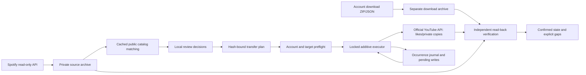

# Architecture and engineering decisions

Spottoyt is a Python application with a Typer CLI and loopback Streamlit UI.
SQLite stores immutable source records, search caches, review decisions and
transfer checkpoints in separate databases. JSON/CSV/Markdown reports provide
portable evidence. The application uses deterministic metadata scoring, not an
LLM, audio fingerprinting or recommendation model.

## Responsibilities

| Module | Responsibility |
|---|---|
| `auth`, `youtube_official` | Spotify PKCE, Google OAuth refresh, explicit credential backend and approved-host HTTP transport |
| `archive`, `exporter`, `importer` | Read-only API snapshots, ZIP safety limits, original-byte checksums and coverage |
| `matching`, `podcasts` | Cached catalog candidates and explainable metadata rankings |
| `review`, `ui` | Persistent choices bound to exact report/row evidence; explicit bulk policy and local controls |
| `transfers`, `playlist_completion` | Frozen plans, preflight, one executor, private-copy mappings and per-occurrence recovery |
| `reconciliation` | Independent observations and gap reports; never repairs an account |
| `demo` | Isolated invented fixtures and a local simulated destination with credentials/network disabled |

## Matching and user intent

The song score weights title, artists, duration and album at 45/30/15/10 points,
with version/explicit-status penalties. Strict metadata labels describe evidence.
The current explicit bulk policy approves the top available music candidate at
85/100 without extra metadata or runner-up-margin gates. Scores are heuristics,
not probabilities. Existing manual choices, skips and deferrals are preserved.
An approved video ID must still match the destination response and be playable.
New plans retain title/duration differences as warnings. Existing dislikes are
not overwritten. Legacy plans keep their recorded metadata policy.

## Recovery and ordering

Source search deduplication preserves every playlist occurrence. Copy mappings
are scoped to the destination account and source playlist. A source-order
signature plus source-position/video-ID checkpoints distinguish intentional
duplicates. Later approvals are inserted into the existing copy at the correct
position, preserving the relative order of existing entries.

The intended insertion is committed before the request. A resume compares the
observed sequence with the saved before/after states. Unknown creation outcomes
require marker reconciliation; a missing marker does not trigger another create.
Successful new resources may take time to appear, so bounded retries apply only
to known read-visibility delays. Writes are never blindly retried.

Local hashes detect accidental changes and stale evidence. An OS lock prevents
two executors in the same workspace. Neither creates an atomic transaction across
services or coordinates another computer. External edits, changed source order
or changed reviews of already-copied occurrences stop completion for inspection.

## Privacy and API boundaries

OAuth grants stay in Windows Credential Manager. Private source/report databases
default outside the repository and OneDrive. They are not encrypted by the app.
HTTPS host restrictions, TLS checks, redirect rejection and request timeouts
bound provider requests. Public catalog matching sends song title/artist queries;
official authenticated writes handle likes and private copies. Unofficial catalog
and player behavior can change. Spotify access is read-only.

The default official adapter does not reproduce separate Music-library saves,
podcast saved-state, album/artist mappings, social follows, playback progress or
listening history. Past plays are archived rather than inferred as current likes.
Default API quota can require multiple batches; local write budgets are not a
measurement of Google's remaining project quota. No paid integration is used.

## Why this structure

Keeping source archives separate from reviews makes corrections and provenance
auditable. Freezing plans prevents later review changes silently altering an
authorized batch. Separating execution from verification distinguishes a request
being accepted from an observed state matching the plan. The synthetic provider
exercises the same engine without credentials, making the project reproducible
and suitable for screenshots while keeping provider limitations explicit.
