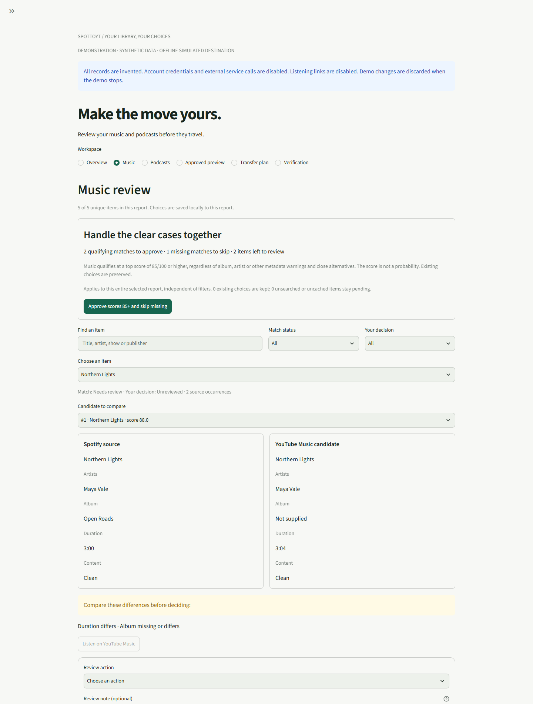
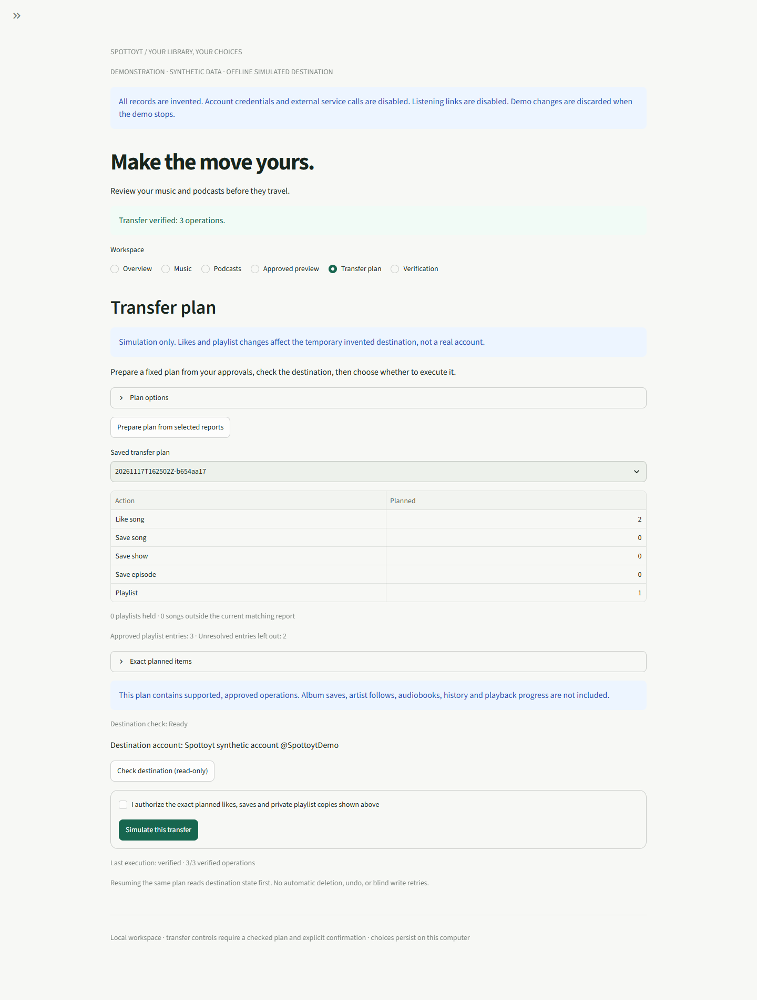
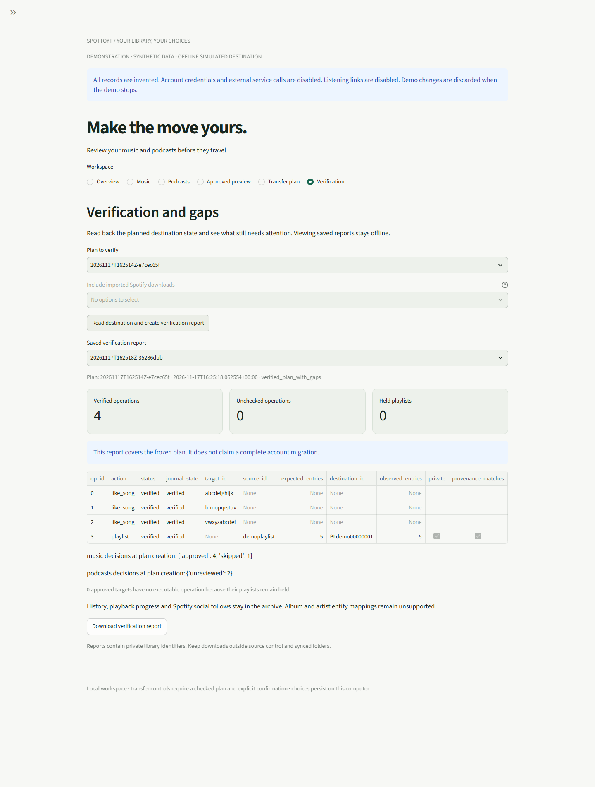

# Offline synthetic demonstration

This demo uses invented tracks and a temporary local destination. It requires
no Spotify/Google account, API credentials, billing or internet access after
dependencies are installed. It demonstrates application behavior, not live
provider compatibility, audio identity or complete account migration.

## Start the interactive demo

From the repository, using the existing Python 3.12 environment:

```powershell
.\.venv\Scripts\spottoyt.exe demo
```

Open **http://127.0.0.1:8502**. The demo uses a different default port from the
real review app. If occupied, choose `demo --port 8503`; existing services are
not stopped. Keep the terminal open. Ctrl+C stops the server and discards its
temporary data. Restarting creates a fresh dataset.

The visible **SYNTHETIC DATA / OFFLINE SIMULATED DESTINATION** banner stays on
every screen. Listening links are disabled. The destination is a local SQLite
simulation; credential-store access and external service requests are blocked.
The demo refuses an unmarked workspace and never loads your real account files.

## Three-minute walkthrough

1. Open **Music**, choose **Northern Lights**, then candidate #1. Its real scoring
   calculation produces 88/100 with missing album metadata and a duration warning.
   Use **Approve scores 85+ and skip missing**. Two songs are approved, one missing
   song is skipped, and two candidates remain for individual review.
2. Open **Transfer plan**. Leave partial copies enabled. Prepare the plan, check
   the simulated destination, tick authorization and **Simulate this transfer**.
   The copy contains three approved entries from five source positions, including
   the repeated Midnight Signals occurrence. Inspect the approved/unresolved counts.
3. Return to **Music**, set **Match status → Needs review** and **Your decision → Unreviewed**. Approve **Paper Planes (Live)** with its invented candidate
   for this simulation, then approve **Window Seat**. The confirmation is a demo
   action; there is no real audio to listen to. Prepare and simulate a new plan.
4. Open **Verification**, select the new plan and create a verification report.
   The same private copy now contains all five reviewed entries in source order.
   The middle gap was filled and the intentional repeated song remains twice.
5. Explore **Podcasts** and the gap reports. Podcast saving, playback history,
   social state and album/artist mapping remain unsupported in the real adapter.







[Mobile screenshot](screenshots/demo-mobile.png).

## Repeat the proof without a browser

```powershell
.\.venv\Scripts\spottoyt.exe demo --walkthrough
```

The command seeds invented data, imports the four synthetic account-download
fixtures, runs real scoring/review/plan/journal/verification code against the
local simulation, and prints JSON. It checks these sequences:

```text
Initial partial: A, A, D
Middle gap:     A, B, A, D
Reviewed copy:  A, B, A, D, E
```

All three phases must reuse one destination ID. Replaying the final plan must
leave simulated destination state unchanged. Output is labeled synthetic and
contains no user account data. Temporary files are removed when it finishes.
[Generated proof](demo-proof.json) records the validated scenario, not live API results.

## Regenerate screenshots and browser evidence

With Microsoft Edge and the project's development dependencies installed:

```powershell
.\.venv\Scripts\python.exe scripts/capture_demo.py
```

The script opens a headless temporary Edge profile, drives the complete review,
partial transfer, later completion and verification flow, checks mobile overflow,
and saves only synthetic screenshots and `demo-proof.json`. It blocks page
requests outside its loopback server and fails on an external page request.
The browser/server stop afterward. No personal browser profile is opened.

The automated scenario additionally tests credential/network guards, refusal to
overwrite an existing workspace, restoration of parent environment variables,
and Windows temporary-folder cleanup. The simulation does not validate live provider credentials, availability or quota.
